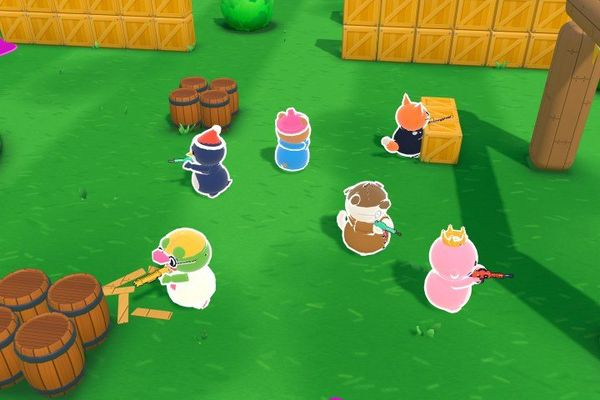

# 🎮 Bullet Brawl

> **A fast-paced, chunky 3D browser-based arcade FPS.** Jump in, grab your weapons, and battle friends in vibrant cartoon arenas!



[](https://python.org)
[](https://threejs.org)
[](https://rapier.rs)
[](#)

---

## 🌟 Overview

**Bullet Brawl** is a standalone, lightweight 3D first-person shooter that runs smoothly directly in your web browser. Built on **Three.js** and **Rapier3D WebAssembly physics**, it combines cute, chunky low-poly animal characters with crisp, responsive arcade gunplay.

Play solo against smart AI bots, challenge rivals in private **1v1 Duels**, or brawl with players worldwide in **Free-For-All** and **Team Deathmatch**!

---

## ✨ Features

- 🐻 **Customizable Chunky Characters**: Customize your animal champion (bears, pigs, ducks, and more) with custom colors, hoodies, caps, sneakers, and accessories.
- 🔫 **Full Arsenal & Dynamic VFX**:
  - Handgun (Pea Popper)
  - Rapid SMG (Buzz SMG)
  - Close-range Shotgun (Bonker)
  - High-precision Sniper (Longneck)
  - Tactical Rifles & Explosives
  - Featuring cartoon muzzle flashes, tracer rounds, and particle effects.
- 🌐 **Seamless Multiplayer & Private Duels**:
  - **1v1 Duels**: Challenge friends with private room codes.
  - **Free-For-All (FFA)**: Classic arena chaos where everyone is an enemy.
  - **Team Deathmatch (6v6)**: Squad up and compete for the highest team score.
  - **Bot Practice Range**: Warm up offline against responsive AI combatants.
- ⚡ **Zero External Bloat**:
  - 100% standalone — zero third-party account requirements.
  - Pure Python backend using only standard libraries.
  - Privacy-first: all player customizations and settings live securely in your browser's `localStorage`.
- 🔊 **Procedural Audio Synthesis**: Dynamic sound effects and arcade soundtracks generated in real-time with zero heavy audio files to download.

---

## ⌨️ Controls

| Action | Key / Control |
| :--- | :--- |
| **Move** | `W`, `A`, `S`, `D` |
| **Look / Aim** | `Mouse` |
| **Shoot** | `Left Click` |
| **Aim Down Sight** | `Right Click` |
| **Jump** | `Space` |
| **Sprint** | `Shift` |
| **Reload** | `R` |
| **Switch Weapons** | `1` - `5` or `Mouse Wheel` |
| **Weapon Shop** | `B` (during match) |
| **Menu / Pause** | `Esc` / `P` |

---

## 🚀 Quick Start (Play Locally)

### Prerequisites
- Python 3.10 or higher installed.

### Run in 2 Steps:
1. Clone the repository:
   ```bash
   git clone https://github.com/SAADALAHSAN/Bullet-Brawl.git
   cd Bullet-Brawl
   ```

2. Start the game server:
   ```bash
   python server.py
   ```

3. Open your browser and navigate to:
   ```
   http://localhost:3000
   ```
   *Enter your nickname and click **PLAY NOW**!*

---

## ☁️ Deploy Online (Render.com)

Bullet Brawl is pre-configured for **1-click free cloud hosting** via [Render](https://render.com):

1. Fork or push this repository to your GitHub account.
2. Sign in to [Render.com](https://render.com) and click **New +** → **Web Service**.
3. Select your `Bullet-Brawl` repository and click **Connect**.
4. Render will automatically read `render.yaml` and configure:
   - **Runtime**: `Python`
   - **Start Command**: `python server.py`
   - **Instance Type**: `Free`
5. Click **Create Web Service** — in 2 minutes you get a live `https://bullet-brawl.onrender.com` link to share with anyone in the world!

---

## 🛠️ Tech Stack

- **Client**: Vanilla JavaScript (ES Modules), Three.js (WebGL 3D Rendering), Rapier3D (WebAssembly Physics Engine).
- **Audio**: Web Audio API Procedural Synthesizer.
- **Server**: Python 3 HTTP & WebSocket Real-time Packet Relay.
- **Hosting**: Render.com / Any Linux or Windows server running Python.

---

## 📄 License

This project is licensed under the MIT License - feel free to play, modify, and host!
